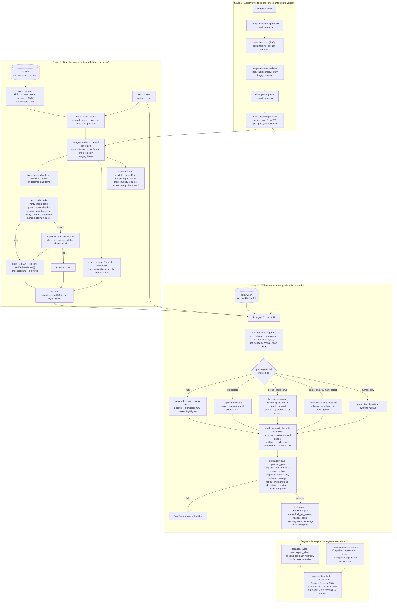

# regulated-doc-agent

The template engine for the AI authoring agent for regulated documents. region compiler, manifest
approval, byte-splicing writer, immutability gate and the code fillers. The LLM pipeline
plugs in by producing a fill plan.

## Guarantees

- **The template is never re-serialised.** The writer splices new bytes into approved spans of
  `document.xml` and header/footer parts. Every other ZIP entry is copied as its raw record, compressed
  bytes included.
- **Every output passes the immutability gate, or no output is produced.** The gate re-resolves the
  approved manifest on the template and proves that every byte outside the masked spans is identical. It
  also checks each masked fragment for markup its mutation does not allow, and compares tables, grids,
  merged cells, checkbox count and option text, section breaks and fields. There is no override flag.
- **A template change needs re-approval.** The manifest pins the SHA-256 of the file and of every part,
  plus each region's byte spans and context hash.
- **Facts and boilerplate never pass through a model.** Code copies them from the system record and the
  approved library (hash-checked). A missing value becomes a numbered gap marker
  `[GAP-n: … — SME input required]`, highlighted.
- **Unknown is never a blank box.** An undecided checklist item is left as it was and listed as a blocking
  item in the report.

## Quickstart

```bash
uv sync
uv run pytest                     # 100 tests
uv run python examples/demo.py    # full CLI flow, writes examples/out/
uv sync --group ui && uv run streamlit run src/docagent/ui.py   # browser UI, see below
```

Open `examples/out/csra_filled.docx` in Word to compare it with `examples/out/csra_template.docx`.

## How a document gets filled, end to end

Three roles, three artefacts. The **template owner** approves *where* the agent may write (the manifest).
The **model** proposes *what* to write, as cited claims that code verifies (the fill plan). **Code** does
the writing, binds facts, and proves the template is untouched (the output and its report). No stage
may skip the one before it: `fill` refuses a plan made for a different manifest, and `author` refuses
an unapproved or edited manifest.



### The steps, in order

**Stage 1, approve the template.** Run once per template version; the output is the manifest.

1. `inspect` / `propose` (`compiler.propose`) read `document.xml` and header/footer parts through the
   expat index (`ooxml/xmlindex.py`) and list every placeholder, heading, table and checkbox with exact
   byte spans. Placeholders split across runs are read as one string (`ooxml/wordml.py`).
2. The template owner edits the proposed `manifest.json`: sets each region's kind, the system-record
   field a `fact` reads, the library key a `boilerplate` region copies, the columns of a `table_rows` region.
3. `approve` (`compiler.approve`) resolves every anchor on the template bytes, refuses overlaps, regions
   inside human-only tables, ambiguous placeholders and hidden formatting, then pins the template's
   SHA-256, each part's SHA-256, each region's spans and a context hash, plus who approved it and when.
   Any later edit to the manifest or the template fails the hash check.

**Stage 2, draft the plan.** Runs per document, only for `prose`, `table_rows`, `single_choice` and
`multi_select` regions; `fact`, `boilerplate` and `human_only` never see a model.

4. Evidence is scoped (`kb.for_system`): only chunks whose `system_id` equals the record's ID **and**
   whose status is `approved`. Drafts and superseded documents are excluded and listed in the audit.
5. Record values are masked (`kb.mask_record_values`): every system-record value inside the evidence
   becomes a `{{system.*}}` token before the model sees it, so the model copies tokens and cannot
   mistype a version or ID. The evidence block is cached across the region calls.
6. `author` makes one JSON-schema call per region (`author.Author`). Every claim item carries the
   sentence, a `chunk_id` and a verbatim quote; anything unsupported is returned as a gap item.
7. Checks 1-3 run in code (`verify.check_claim`): the quote is in the cited chunk, the chunk belongs to
   the target system, and every number, acronym and proper name in the claim appears in the quote.
8. Claims that pass go to one judge call per region: does the quote entail the whole claim? A "no"
   decision on a checklist item may cite evidence that states something else, so the judge decides those.
9. Any failure rewrites the claim as `{{GAP: topic (no verified evidence)}}`; a de-identification
   surrogate in the text becomes `{{GAP: … (de-identified detail)}}`; a checklist item becomes `unknown`.
10. A `single_choice` region is sampled three times. All samples must agree on a non-unknown option and
    the first citation must pass steps 7-8; otherwise the choice is `null` and the writer blocks sign-off.
11. Output: `plan.json` (bound to the approved manifest hash) and `plan.audit.json` (model, request
    IDs, prompt and output hashes, cited chunk IDs, quote hashes, each check's result, excluded chunks).
    No prompt, quote or output text is stored. A refusal or missing evidence leaves the region out of
    the plan, which the writer turns into a gap.

**Stage 3, write the document.** Pure code; the same path runs with or without a plan.

12. `fill` (`writer.fill`) loads the approved manifest and re-resolves every region on the template
    bytes (`compiler.load_approved`). It refuses a plan whose `manifest_sha256` differs, a plan that
    names an unknown region, or a plan that names a `fact`, `boilerplate` or `human_only` region.
13. Each region is filled by kind (`writer._Filler`): facts are copied from the system record,
    boilerplate from the library after a hash check, prose and rows from the plan with `{{system.*}}`
    bound late and `{{GAP: …}}` numbered, checkboxes flipped in place, human-only regions untouched.
    A missing fact becomes a highlighted `[GAP-n: … — SME input required]`; an unknown checklist item
    is left as it was and recorded as a blocking item.
14. `render.py` emits the only new XML. The writer splices it into the approved byte spans and
    `package.rebuild` copies every other ZIP entry as its raw record, compressed bytes included.
15. The immutability gate (`gate.run_gate`) re-resolves the manifest on the template, proves every
    byte outside the masked spans is identical, checks each fragment for markup its mutation does not
    allow, and compares tables, grids, merged cells, checkbox count and option text, section breaks and
    fields. There is no override: a failure raises and nothing is written.
16. Output: `draft.docx` and `draft.report.json` (template, manifest, record, plan and output hashes,
    per-region status `filled` / `gap` / `blocked` / `awaiting_human`, numbered gaps, blocking items,
    gate result). `docagent gate` re-runs step 15 on any output at any later time.

**Stage 4, prove 99%.** See [Proving 99%](#proving-99-the-golden-set-loop) for the numbers.

17. `label` runs the golden set through stage 2 and exports one line per claim, with text, for SMEs.
18. `evaluate` computes claim-level precision with a one-sided 95% Clopper-Pearson lower bound per
    region kind, on the tune split while fixing and once on the test split for the verdict. Each error
    becomes a new deterministic check or prompt rule. `examples/stress_test.py` runs the same loop on
    15 synthetic systems with traps, graded automatically against an answer key.

### Where each step is tested

`uv run pytest` runs all 100 tests against `tests/fixtures/csra.py`, a Computer System Risk Assessment
template built with the hard cases (split-run placeholders, every checkbox form, merged cells, section
breaks, bookmarks, tracked changes), and `tests/fixtures/kb.py`, a synthetic knowledge base that
includes another system's documents as a trap. Model calls in tests use a scripted fake LLM.

| Steps | Module | Tests | What they prove |
|---|---|---|---|
| 1 | `ooxml/package.py`, `ooxml/xmlindex.py`, `ooxml/wordml.py` | `test_package.py` (6), `test_wordml.py` (8) | raw ZIP copy is byte-identical, spans slice exact elements, split runs read as one string, all three checkbox forms found, tracked changes and DOCTYPE refused |
| 1-3 | `compiler.py`, `manifest.py` | `test_compiler.py` (11) | proposal finds every kind, approval pins spans and hashes, edits after approval and revised templates refused, overlaps / ambiguity / hidden formatting refused |
| 4-11 | `kb.py`, `verify.py`, `author.py`, `llm.py` | `test_author.py` (13) | record values masked before the model, unsourced terms caught, bad claims become gaps, audit records why, checklist answers need citations, single choice needs agreeing samples, refusal and no-evidence paths, unapproved manifest refused, a drafted plan fills and passes the gate |
| 12-14, 16 | `writer.py`, `plan.py`, `render.py` | `test_writer.py` (15) | every region reads back filled, report lists gaps / blockers / human regions, checkbox flipped in place, split-run placeholder keeps every run, gap markers highlighted, bad or foreign plans refused, tampered boilerplate refused, output deterministic, special characters survive |
| 15 | `gate.py` | `test_gate.py` (8) | any byte outside a region rejected, odd markup inside a region rejected, parts without regions must be identical, reordered parts rejected, a false witness cannot widen the mask |
| 17-18 | `eval.py` | `test_eval.py` (7) | lower bound matches the design doc, sample sizes for 99%, unlabelled claims block a pass, test split kept separate |
| 18 | `tests/fixtures/synthetic.py`, `examples/stress_test.py` | `test_synthetic.py` (2) | generator is deterministic and plants its traps, auto-labeller grades against the answer key |
| 1-3, 12-16 via the browser | `ui.py` | `test_ui.py` (4) | demo loads, approval pins the manifest, fill with and without a plan gives the CLI demo's statuses, a plan for another manifest is flagged, clear resets state |

`examples/demo.py` runs stages 1 and 3 end to end without a key; `examples/demo_llm.py` adds stage 2
with the real model; `examples/demo_eval.py` runs stage 4 on one case.

## Browser UI

```bash
uv sync --group ui
uv run streamlit run src/docagent/ui.py
```

Opens at http://localhost:8501. The page is the CLI flow as six tabs, in order, with the sidebar showing
what is loaded and what is still missing. It calls the package API directly; nothing in it bypasses
manifest approval or the immutability gate.

| Tab | What you do there | Behind it |
|---|---|---|
| 1 Template | Upload the approved `.docx`; see every paragraph, heading, checkbox and table the compiler finds | `TemplateDoc` |
| 2 Regions | Propose regions, edit the manifest JSON (kinds, fact sources, library keys, columns), approve with name and role, download `manifest.json` | `propose`, `approve` |
| 3 Inputs | Paste or upload the system record, boilerplate library and knowledge base; each is validated and the KB shows how many chunks are usable evidence for the record | pydantic models, `kb.for_system` |
| 4 Draft | Pick the model and sample count, draft the plan; see claims drafted / verified / gaps per region; edit or hand-write `plan.json`; download the audit | `author`, `AnthropicLLM` |
| 5 Fill | Fill the document; see region statuses, gap markers, blocking items and awaiting-human regions; download the filled `.docx` and `report.json` | `fill`, `run_gate` |
| 6 Gate | Upload any earlier output and re-run the gate against the loaded template and manifest, with its report as witness | `run_gate` |

**Load demo (CSRA template)** in the sidebar fills every input from the test fixtures so the whole flow
can be tried without customer data. Drafting needs Anthropic credentials, read from `.env` or
`ANTHROPIC_API_KEY`; every other tab works offline. `tests/test_ui.py` drives the page headlessly
through `streamlit.testing` and checks that the UI produces the same region statuses as the CLI demo.

## Workflow

```bash
docagent inspect  template.docx                                   # what the compiler sees
docagent propose  template.docx -o manifest.json                  # draft regions from the template's own signals
#   template owner edits manifest.json: kinds, fact sources, boilerplate keys, columns
docagent approve  manifest.json --template template.docx --by "Name (QA)"
docagent fill     --template template.docx --manifest manifest.json --record record.json \
                  --plan plan.json --library library.json -o draft.docx
docagent gate     --template template.docx --output draft.docx --manifest manifest.json
```

`fill` writes `draft.report.json` next to the output, with the template, manifest, record, plan and
output hashes, region statuses, gaps, blocking items and the gate result. It records identifiers and
hashes, not document content.

## Region kinds

| Kind | Mutation | Filled by | Check |
|---|---|---|---|
| `boilerplate` | `paragraphs` or `inline_text` | approved library entry | entry hash equals the pinned hash |
| `human_only` | `none` | nobody; left for signature | no other region may touch it |
| `fact` | `inline_text` | system record (`source: system.version`) | value copied, record hash logged |
| `prose` | `paragraphs` or `inline_text` | fill plan | tokens only, no markup |
| `table_rows` | `rows` | fill plan, code numbers rows | row cloned from the prototype (tcPr, gridSpan, vMerge) |
| `single_choice` | `checkbox_state` or `inline_text` | fill plan | value is in the template's option set |
| `multi_select` | `checkbox_state` (`single_box` or `yes_no`) | fill plan | unknown items block sign-off |

Anchors match placeholder text across run boundaries, so placeholders that Word splits with `w:proofErr`
or revision IDs still resolve. New text takes the placeholder run's properties.

## Fill plan

```json
{
  "plan_version": 1,
  "manifest_sha256": "<approval.manifest_sha256>",
  "regions": {
    "system_description": {"paragraphs": ["{{system.name}} records QC results.", "{{GAP: number of users}} users."]},
    "requirements_rows": {"rows": [{"requirement": "…", "gxp_impact": "Direct", "risk": "High"}]},
    "overall_risk": {"choice": "Medium"},
    "gxp_applicability": {"items": {"21 CFR Part 11": "yes", "EU GMP Annex 11": "unknown"}}
  }
}
```

`{{system.*}}` is bound late from the system record, so the model never types a fact. `{{GAP: …}}` is
numbered by the writer. A plan may not name fact, boilerplate or human-only regions.

## Drafting with the model (phase 3, first slice)

```bash
docagent author --manifest manifest.json --record record.json --kb kb.json -o plan.json
uv run python examples/demo_llm.py    # after examples/demo.py; key from ANTHROPIC_API_KEY or .env
```

Put the key in `.env` (copy `.env.example`; it is gitignored) or export `ANTHROPIC_API_KEY`.

`author` produces the same `plan.json` the writer already takes:

1. **Evidence is scoped to the target system.** Only chunks whose `system_id` equals the record's ID are
   shown, and record values inside them are masked as `{{system.*}}` tokens. The model copies tokens,
   so it cannot mistype a version or ID.
2. **The model drafts atomic claims.** One call per region with a JSON schema; every claim carries a
   chunk ID and a verbatim quote, and anything unsupported comes back as a gap item.
3. **Every claim is checked.** In code: the quote is in the cited chunk, the chunk is the target system's,
   and every number, acronym and proper name in the claim is in the quote. Then a separate judge call
   asks whether the quote supports the whole claim. Any failure turns the claim into
   `{{GAP: … (no verified evidence)}}`, and a checklist item into `unknown`.
4. **A single choice needs three samples that agree** and a verified citation; otherwise it is left
   unchosen and blocks sign-off.
5. **Audit:** `plan.audit.json` records the model, request IDs, prompt and output hashes, cited chunk
   IDs, quote hashes and each check's result. No prompt, quote or output text is stored.

The model is pinned (`claude-opus-5-5` by default) and there is no automatic fallback to another model:
a refusal leaves the region for the writer to gap.

## Proving 99%: the golden-set loop

99% is claim-level precision: of the claims the pipeline asserts, at least 99% are correct, shown with a
one-sided 95% Clopper-Pearson lower bound per region kind. Gap markers are abstentions and do not count
against precision; they lower coverage, which is reported separately.

```bash
docagent label    --golden golden.json --manifest manifest.json -o labels.jsonl   # one line per claim, with text
#   SMEs set "label": true|false on every accepted claim (and on rejected ones, to measure lost coverage)
docagent evaluate labels.jsonl --split tune            # fix what fails here
docagent evaluate labels.jsonl --split test            # final verdict only; never used for tuning
uv run python examples/demo_eval.py                    # demo with one case
```

| Errors among labelled claims | Claims needed for a pass |
|---|---|
| 0 | 299 |
| 1 | 473 |
| 2 | 628 |
| 3 | 773 |

`evaluate` exits 1 while any region kind has an unlabelled claim or a lower bound under the target, and
prints how many claims the current error count would need. Each error goes back into the pipeline as a
new deterministic check or prompt rule, re-measured on the tune split; the test split is read once.

**Local stress test without customer data.** `uv run python examples/stress_test.py` builds 15 synthetic
systems (`tests/fixtures/synthetic.py`), each with approved documents plus traps: another system's chunk,
a draft risk assessment, a superseded summary with a different GAMP category, surrogates, and ratings that
exist only in trap documents. An answer key grades every exported claim automatically, exactly for
structured regions and by a conservative heuristic for prose. It shows which checks leak; it does not
replace SME labels on real documents.

Evidence controls that already feed this: only the target system's **approved** documents are evidence
(drafts and superseded documents are listed in the audit as excluded), the document version travels
with every chunk to the drafter and the judge, de-identification surrogates may not be copied into a
claim, and every number, acronym and proper name in a claim must appear in its quote.

## Layout

```
src/docagent/
  ooxml/package.py   ZIP reader/writer with raw entry copy
  ooxml/xmlindex.py  expat index with exact byte spans per element
  ooxml/text.py      w:t character-to-byte mapping, escaping
  ooxml/wordml.py    paragraph text across runs, sections, tables, checkboxes
  manifest.py        region manifest schema and hashing
  compiler.py        anchor resolution, approval, proposal
  plan.py            system record, boilerplate library, fill plan, tokens
  render.py          the only XML the writer emits
  writer.py          fillers per region kind, splicing
  gate.py            immutability gate
  kb.py              knowledge base, system scoping, record-value masking
  llm.py             model gateway (Anthropic adapter), content-free call metadata
  verify.py          deterministic claim checks
  author.py          grounded drafting: draft, check, judge, plan + audit
  eval.py            golden set, SME labels, precision with 95% lower bound
  cli.py
  ui.py              Streamlit page over the same API (optional `ui` dependency group)
tests/fixtures/csra.py   a Computer System Risk Assessment template with the hard cases
tests/fixtures/kb.py     synthetic past documents, plus another system's
```

## Not yet supported

These are refused or reported as warnings rather than handled:

- Content controls and bookmarks as anchors (open question 2 in the design doc). Plain-text placeholders,
  tables and checkboxes work now.
- Checkbox content controls that wrap whole paragraphs, and Wingdings `w:sym` checkboxes.
- Templates with unaccepted tracked changes, Strict OOXML, ZIP64 or encrypted packages.
- Placeholders in footnotes, endnotes, comments and text boxes.

## Phase 1 exit gate

The gate already blocks any masked-diff byte. The remaining exit criterion is to run real customer
templates through and confirm that Word opens every output without repair.
